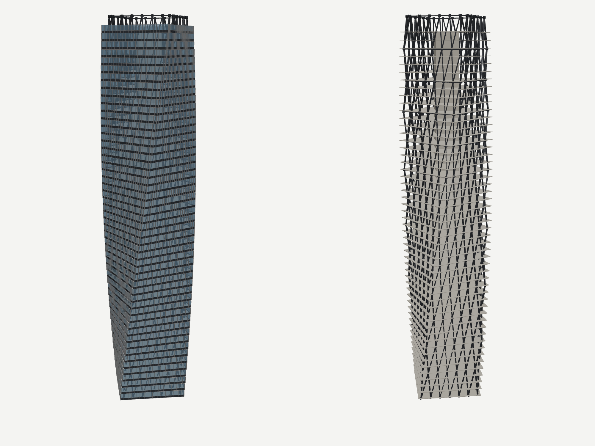

# GH AI 빌더 — 말로 적으면 그래스호퍼 정의를 만들어 주는 도구

[](https://github.com/juhyeonglee-arch/gh-ai-builder/actions/workflows/ci.yml)

설계 의도를 말로 적으면, Rhino 8 그래스호퍼 캔버스에 **진짜 컴포넌트가 선으로 이어진 정의**가 만들어지고,
결과를 재료별 레이어와 블록으로 정리해 Rhino 객체로 **Bake**할 수 있는 도구예요.



## 무엇을 하나요

1. **정의 설계도(그래프 JSON)** 를 받아요. 노드(컴포넌트), 선, 그룹, 재료, 블록이 적혀 있어요.
   - Claude와 대화하며 JSON을 받아 붙여 넣는 방식(무료)이 기본이에요.
   - 원하면 Claude API 키를 넣어 빌더가 직접 JSON을 만들게 할 수도 있어요(유료, 선택).
2. 그래스호퍼 캔버스에 실제 컴포넌트를 놓고 선을 이어요. 그룹은 알고리즘 단계, "설명" 패널은 논리와 쓰는 법이에요.
3. **[결과 Bake]** 를 누르면 `GH_AI::제목::재료::부재` 레이어로, 반복 부재는 Rhino 블록으로 들어가요.
4. 정의 정보는 캔버스 패널에 같이 저장돼서 .gh를 다시 열어도 고치기·Bake가 이어져요.

## 쓰는 법 (Rhino 8, 설치 없음)

1. [Releases](https://github.com/juhyeonglee-arch/gh-ai-builder/releases)에서 `GH_AI_builder.py`를 내려받아요.
   (또는 이 저장소의 [`src/GH_AI_builder.py`](src/GH_AI_builder.py) → Download raw file)
2. Rhino 8 명령창에 `RunPythonScript` → 내려받은 파일을 골라요. 빌더 창이 떠요.
3. "만들고 싶은 것" 칸에 그래프 JSON을 붙여 넣고 **[새로 만들기]**.
   [`examples/`](examples) 폴더의 JSON으로 바로 시험해 볼 수 있어요.
4. 슬라이더로 형태를 바꾸고, **[결과 Bake]** 로 Rhino에 넣어요.
5. 고치고 싶으면 **[지금 정의 JSON 복사]** 로 지금 상태를 복사해 대화에 붙이고 고칠 점을 적어요.

자세한 버튼 설명은 [`src/사용법.txt`](src/사용법.txt)에 있어요.

> **API 키 (선택)** — 키는 저장소에 절대 넣지 않아요. 빌더 창에 직접 입력하면 내 PC의
> `%APPDATA%\GH_AI\api_key.txt` 에만 저장돼요. 환경변수 `ANTHROPIC_API_KEY` 로 줘도 돼요.

> **내 파일** — 개인 도면(.3dm, .gh 등)이나 재배포가 금지된 자료는 이 저장소에 올리지 않아요.
> 빌더는 사용자가 자기 Rhino 파일에서 직접 실행하는 방식이라 그런 파일이 필요 없어요.
> 저장소 안에 `private/` 폴더를 만들어 두면 Git이 무시해요.

## 예제

| 파일 | 내용 |
|---|---|
| `01_세로루버_각도변화` | 벽 앞 세로 루버, 각도가 점점 변함 |
| `02_곡선벽돌벽_회전쌓기` | 벽돌을 반 장씩 엇갈려 쌓고 위로 갈수록 회전 |
| `03_50층_비틀린다이아그리드` | 타워 개념, 선 위주 |
| `04_50층_다이아그리드_v2_부재재료` | 부재·재료 1차 |
| `08_비틀린다이아그리드타워_v3` | **대표 예제.** 구조(대각재·링 보·주강 노드·볼트) + 유닛 커튼월, 블록 Bake |

08은 손으로 고치지 않고 [`examples/gen/gen_08_tower_v3.py`](examples/gen/gen_08_tower_v3.py)를 고쳐 다시 만들어요.

## 자동 시험 (GitHub Actions)

커밋과 PR마다 **Windows와 Linux**에서 자동으로 돌아요. Rhino·그래스호퍼는 Actions에서 돌릴 수 없어서,
Rhino 없이 정의를 계산해 보는 **그래스호퍼 흉내 검사기**(`tests/ghsim.py`)로 확인해요.

| 시험 | 통과 조건 |
|---|---|
| 빌더 로직 시험 | `tests/test_logic.py` 가 끝까지 통과 |
| 이름 검사 | 예제의 모든 컴포넌트·입력·출력 이름이 Rhino 8 실제 목록(`tests/real_catalog_rhino8.txt`)에 있음 |
| 생성 스크립트 재현 | 생성기를 다시 돌린 결과가 커밋된 JSON과 똑같음 |
| 검사기 계산 | 예제마다 오류 0개, Bake 결과 1개 이상 |
| 간섭 검사 | 08 타워 구조 부재가 유리 선을 뚫지 않음 |
| 그림 | 예제별 간이 그림(두 OS), 08 타워 3D 렌더 4장(Linux) |

결과 표는 각 실행의 **Summary**에, 그림은 **Artifacts**(`시험그림-…`)에 남아요.
마지막 확인(실제 Rhino에서 실행)은 사람이 해야 해요.

내 PC에서 똑같이 돌리려면 (개발자용):

```bash
pip install numpy shapely pillow
python tests/ci_run.py --out ci_out
```

## 폴더 구조

```
src/        빌더 (Rhino 8에서 RunPythonScript로 실행) + 사용법
examples/   붙여 넣는 정의 JSON, gen/ 생성 스크립트
tests/      검사기(ghsim), 실제 컴포넌트 목록, 이름 검사, 간섭 검사, 3D 렌더 도구, ci_run.py
renders/    08 타워 확인 그림
docs/       개발 노트 (JSON 형식, 검사기, 겪은 오류, 남은 일)
.github/    자동 시험 설정
```

## 개선 방식

개선은 브랜치에서 작업하고 PR로 올려요. PR에는 바뀐 점, 시험 통과 여부, 확인 그림이 들어가고,
시험이 통과하지 않은 PR은 검토로 넘기지 않아요.
